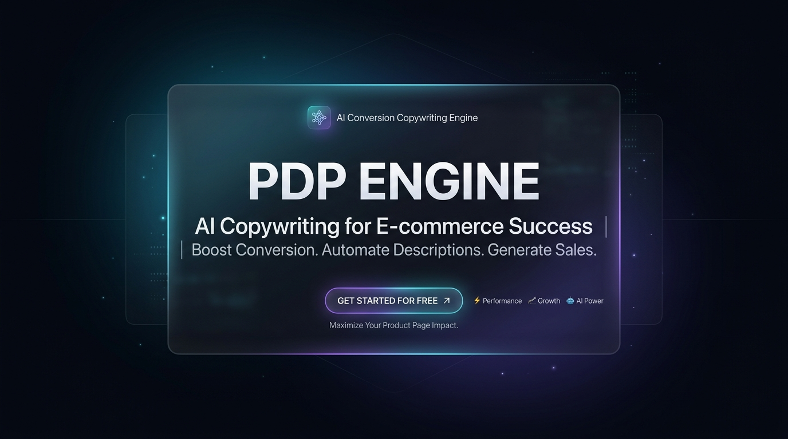
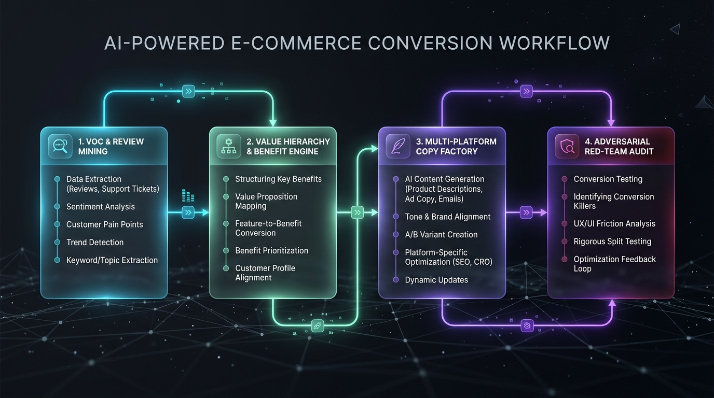

<p align="center">
  
</p>

<div align="center">

[](LICENSE)
[](SKILL.md)
[](#-platform-compliance-matrix)
[](evals/rubric_100_points.json)
[](CONTRIBUTING.md)

### The Autonomous E-Commerce Conversion Architecture
**Transform Raw Specs & Customer Reviews into High-Converting, Algorithm-Compliant Listings**

[Architecture](#-conversion-architecture) • [Live Comparison](#-real-world-comparison-generic-ai-vs-pdp-engine) • [Core Pillars](#-core-conversion-pillars) • [Quickstart](#-quickstart) • [Case Study](examples/demo_portable_espresso_machine.md)

---

</div>

## 💡 The Problem & The Solution

90% of e-commerce listings written with generic AI prompts suffer from three critical flaws that destroy conversion:

1. **Bare Technical Specs**: Dumping raw numbers like `20Bar` or `7500mAh` that shoppers cannot contextualize.
2. **Unsubstantiated Fluff**: Relying on words like *"revolutionary"*, *"best quality"*, or *"100% guarantee"* that trigger consumer distrust and Amazon TOS violations.
3. **Ignored Customer Objections**: Failing to preempt the #1 reasons customers hesitate or return products (*"Is it hard to clean? Does the battery fail in the cold?"*).

**`PDP Engine`** replaces unconstrained AI writing with a rigorous, four-stage conversion architecture:

---

## 🏛️ Conversion Architecture

<p align="center">
  
</p>

The engine executes four linear stages backed by continuous adversarial verification:
1. **VoC & Review Mining**: Extracts customer frustration facets and Jobs-to-be-Done (JTBD) motives from 1-star to 5-star competitor reviews.
2. **Value Hierarchy & Benefit Engine**: Translates physical metrics into quantified daily benefits via the P2B formula and Golden Ranking principle.
3. **Multi-Platform Copy Factory**: Formats copy to strict algorithm constraints for Amazon A9/COSMO, Shopify DTC, and TikTok Shop.
4. **Adversarial Red-Team Audit**: Deploys a Skeptical Buyer Persona and Compliance Guard to stress-test claims before final delivery.

---

## 🥊 Real-World Comparison: Generic AI vs. PDP Engine

Here is a side-by-side comparison for a **Cordless Self-Heating Espresso Maker**:

| Dimension | ❌ Generic ChatGPT-4o Output | 💎 PDP Engine Output |
| :--- | :--- | :--- |
| **Hero Feature Hook** | *"Features a powerful 20Bar pressure pump for great coffee extraction. Durable and high quality."*<br>*(Empty claims, bare numbers, zero sensory resonance)* | **"☕ 【RICH, VELVETY CREMA EVERYWHERE】"**<br>Italian 20-Bar commercial extraction compresses a $2,000 café workshop into your travel cup. Say goodbye to the watery, sour black coffee of standard travel makers. |
| **Objection Preemption (Cleaning Friction)** | *"Waterproof and easy to clean with water."*<br>*(Vague, does not address the #1 return reason: moldy crevices)* | **"🧼 【10-SECOND RINSE & ZERO-MOLD DESIGN】"**<br>Magnetic quick-release chamber with IPX6 waterproofing. Zero hard-to-reach crevices means no stale coffee sludge, zero mold, and leak-free travel bag storage. |
| **Marketplace Compliance** | *"The best espresso maker on the market. 100% satisfaction guaranteed."*<br>*(Violates Amazon Listing TOS: 'best', 'guaranteed')* | **Compliant title & five points**: 193-character title with front-loaded search terms, zero banned superlatives, and 198-byte comma-free backend keywords. |
| **Adversarial Defense** | Crumbles under skeptical review. Leaves buyers unsure if heating works in freezing winter temperatures. | **Preemptive cold-weather proof**: Automatically integrates lab-tested winter tolerance notes (*"Operates flawlessly in sub-zero -5°C snow camping"*). |

> 📖 View full Amazon & Shopify multi-platform outputs: [examples/SHOWCASE_COMPARISON.md](examples/SHOWCASE_COMPARISON.md)

---

## 💎 Core Conversion Pillars

### 1. Parameter-to-Benefit (P2B) Engine
Enforces the **Zero-Bare-Spec Rule**: No physical specification can appear in marketing copy without answering: *What measurable time, money, or comfort does this give the customer?*
$$\text{Physical Parameter} \xrightarrow{\text{Mechanical Function}} \text{Measurable Benefit} \xrightarrow{\text{Emotional Payoff}}$$

### 2. Golden Ranking Hierarchy
Allocates page visual hierarchy based on defensible moats:
- 🥇 **Unique Advantage (人无我有)**: Proprietary tech and patented designs $\rightarrow$ **Hero headline and top visual**.
- 🥈 **Superior Performance (人有我优)**: Proven performance beat rates $\rightarrow$ **Second-screen comparison matrix**.
- 🥉 **Distinct Positioning (人优我异)**: Aesthetic, service, and lifestyle framing $\rightarrow$ **Third-screen storytelling**.

### 3. Multi-Platform Compliance Matrix
- **Amazon A9/COSMO**: Under 200 characters title, capitalized benefit hooks in bullets, under 249 bytes backend search terms, zero prohibited keywords.
- **Shopify DTC**: 2-sentence Buy-Box conversion hook, mobile-first AIDA scroll narrative, and Google `JSON-LD` Product schema markup.
- **TikTok Shop**: 3-second hook format targeting impulse buyer psychology.

### 4. Adversarial Red-Team Audit
Every generated listing undergoes rigorous stress-testing:
- **Skeptical Buyer Agent**: Simulates an experienced, distrustful consumer asking the hardest questions before purchasing.
- **Regulatory Guard**: Flags FTC false-advertising hazards, medical claims, and marketplace compliance violations.

---

## 📂 Project Structure

```text
ecommerce-pdp-generator/
├── SKILL.md                          # Antigravity Agent Skill Specification
├── README.md                         # Project Presentation & Documentation
├── LICENSE                           # MIT Open-Source License
├── CONTRIBUTING.md                   # Contribution Guidelines
├── assets/                           # High-Resolution Architectural Visuals
│   ├── hero_banner.jpg               # Hero Banner Graphic
│   └── architecture_diagram.jpg      # 4-Stage Conversion Architecture Diagram
├── prompts/                          # Modular Prompt Engineering Assets
│   ├── 01_voc_jtbd_mining.md         # Voice of Customer & JTBD Analysis
│   ├── 02_p2b_benefit_engine.md      # Parameter-to-Benefit Translation Matrix
│   ├── 03_value_triad_ranking.md     # Golden Ranking Hierarchy Protocol
│   ├── 04_platform_headline_matrix.md# Amazon & Shopify Headline Factory
│   ├── 05_aida_conversion_funnel.md  # AIDA Mobile Persuasion Sequence
│   ├── 06_modular_copy_factory.md    # 6-Block Core Marketing Copy Blocks
│   ├── 07_visual_prompt_storyboard.md# Midjourney / Flux Photography Prompts
│   └── 08_adversarial_red_team_audit.md # Red-Team Skeptical Buyer Review
├── templates/                        # Output Templates & Schemas
│   ├── pdp_schemas.json              # Standardized JSON Schema
│   ├── pdp_shopify_template.md       # Shopify DTC Listing Template
│   └── pdp_amazon_template.md        # Amazon A9/A10 Listing Template
├── evals/                            # Quality Benchmarks
│   └── rubric_100_points.json        # 100-Point Composite Conversion Rubric
├── docs/                             # Deep Technical Specifications
│   └── ARCHITECTURE.md               # Pipeline & NLP Mechanics
└── examples/                         # Production Examples
    ├── SHOWCASE_COMPARISON.md        # Generic AI vs. PDP Engine Head-to-Head
    └── demo_portable_espresso_machine.md # Full-Lifecycle Case Study
```

---

## 🚀 Quickstart

### In Google Antigravity / Claude Agent
Clone or link into `.agents/skills/ecommerce-pdp-generator`, then run:

```text
/skill ecommerce-pdp-generator
Platform: Shopify DTC (or Amazon A9)
Product: Cordless Self-Heating Espresso Maker
Specs: 20-Bar extraction, 7500mAh battery, 650g weight, IPX6 washable
Competitor Pain Points: Water must be pre-boiled, weak crema, hard to clean
Target Audience: Business travelers, outdoor camping enthusiasts
```

---

## 🤝 Contributing & License

Contributions, platform template extensions, and evaluation cases are welcome!
This project is open-sourced under the [MIT License](LICENSE).
