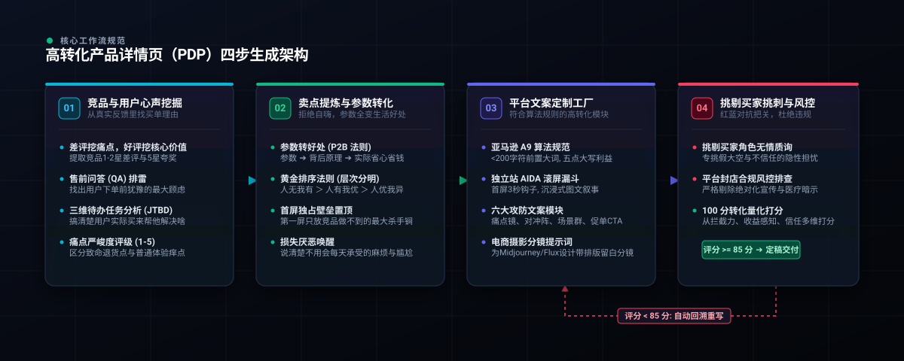

<p align="center">
  
</p>

<div align="center">

[English](README.md) • **简体中文**

[](LICENSE)
[](SKILL.md)
[](#-多平台算法适配)
[](evals/rubric_100_points.json)
[](CONTRIBUTING.md)

<p align="center">
  <b>做独立站与跨境电商出海，产品详情页（PDP）是决定转化率的命根子。</b><br>
  别再让密密麻麻的冰冷参数劝退客户。参考亚马逊 Go-to-Market (GTM) 策略框架，用真实用户心声与黄金卖点法则，把技术指标翻译成买家听得懂、愿意买单的好处。
</p>

[GTM 核心理念](#-什么是电商详情页的-go-to-market-gtm-策略) • [三大战略基石](#-高转化详情页的三大-gtm-战略基石) • [四步落地流程](#-四步打造高转化详情页-gtm-实施路线) • [实战真实对比](#-实战真实对比自嗨文案-vs-本工具生成的精准种草文案) • [极速上手](#-30秒极速上手) • [系列项目规范](docs/SERIES_METHODOLOGY.md)

---

</div>

## 🎯 什么是电商详情页的 Go-to-Market (GTM) 策略？

> **“Think of a go-to-market strategy as the north star that guides your product launch.”**  
> —— 亚马逊广告官方 GTM 指南

在跨境电商与独立站出海中，很多卖家把大把的美金砸在 Google 广告、Meta 投流和 TikTok 网红带货上。流量确实进来了，但跳出率高达 80%，跳出后的客户再也没回来。

**问题不在流量，而在你的承接页——产品详情页（PDP）。**

详情页不是给工厂技术员看的“产品规格书”，它是你在海外市场 7×24 小时面对买家的**唯一销售代表**。

一个合格的详情页 GTM 策略，是在你烧第一笔广告费之前，在前端把所有关键功课做透：
1. **摸透买家心声（Understand Your Audience）**：他们之前买了同类竞品，最深恶痛绝的痛点是什么？
2. **摸清竞争格局（Understand the Competition）**：同类产品都在吹什么？你的独家护城河到底在哪里？
3. **建立精准联结（Connect with Your Target Audience）**：把冰冷的参数翻译成生活中的即时收益，前置打消下单疑虑。

**`ecommerce-pdp-generator`** 正是将这套一线外贸实战操盘手经验与亚马逊 GTM 框架深度融合的自动化 Agent 技能。

---

## 🏛️ 高转化详情页的三大 GTM 战略基石

参考亚马逊 GTM 核心框架，我们将详情页生产拆解为三大底层支柱，拒绝任何无意义的自嗨：

| 战略基石 | 核心操盘抓手 | 落地价值与产出 |
| :--- | :--- | :--- |
| **1. 洞察真实受众<br/>(Understand Audience)** | 逆向抓取竞品 1-2 星差评、5 星好评与 QA 问答，提炼买家未满足的需求（Unmet Needs）。 | 摸清买家决策心理，抓准他们愿意掏钱的触发点，而不是凭空臆想。 |
| **2. 吃透竞品破绽<br/>(Understand Competition)** | 执行 **P2B 参数变好处法则 (Parameter-to-Benefit)**，用公式将物理参数翻译成人话。 | 严禁出现孤立数字（如 20Bar、7500mAh），每一项参数都必须对应生活收益。 |
| **3. 抢占黄金生态位<br/>(Connect & Position)** | 严格执行**“人无我有 ＞ 人有我优 ＞ 人优我异”**黄金排序法则，配合 AIDA 递进动线。 | 最大竞争壁垒推首屏，二屏做对比消灭顾虑，三屏讲生活方式，末尾兜底无忧承诺。 |

---

## 🔄 四步打造高转化详情页：GTM 实施路线

<p align="center">
  
</p>

按照亚马逊 GTM 的 4 步演进路径，本工具将详情页生产标准化为 4 个清晰交付阶段：

### 📍 Step 1. 深度调研，再调研 (Research, and then research again)
- **差评狙击**：挖掘竞品 1-2 星差评（如漏水、异味、塑料感、操作繁琐），将竞品的缺陷转化为你的核心卖点。
- **好评锚定**：提取买家自发使用场景与情绪词（如“救了我的露营周末”、“每天早上省了15分钟”）。
- **问答排障**：汇总高频售前疑虑，在详情页首屏与 FAQ 中提前化解。

### 📍 Step 2. 彻底摸清竞品破绽 (Understand the competition)
- **参数向收益转化 (P2B Engine)**：
  $$\text{物理参数} \xrightarrow{\text{运作原理}} \text{生活收益} \xrightarrow{\text{情绪终局}}$$
  *错误示范*：“内置 7500mAh 动力电池。”  
  *正确示范*：“充满一次电，自驾露营 4 天 3 晚手机和无人机无需到处找插座，彻底告别电量焦虑。”

### 📍 Step 3. 精准触达目标受众 (Connect with your target audience)
- **黄金排位原则**：
  - 🥇 **人无我有**：竞品都没有的独家特性（如冷水即热、磁吸快拆），**必须放在首屏主图和首段核心标题**。
  - 🥈 **人有我优**：大家都有但你参数更好（如 20Bar vs 竞品 15Bar），放在**第二屏做直观硬核参数对比表**。
  - 🥉 **人优我异**：性能差不多时换角度讲差异（如极简北欧美学、商务出差体面），放在**第三屏讲生活方式**。
- **多平台合规文案工厂**：
  - **亚马逊 A9 / COSMO 专线**：200 字符内精准控容，核心大词前置，五点描述大写利益词，零绝对化违禁词。
  - **Shopify / 独立站专线**：首屏 2 句话极简 Buy-Box 钩子，移动端文字绝不超过 4 行，AIDA 动线层层推进。
  - **电商摄影分镜提示词**：配套 Midjourney / Flux 分镜 Prompt，严格预留画面留白（Copy Space）。

### 📍 Step 4. 抢占心智，抢第一 (Be first, or close to it)
- **红蓝对抗审查**：生成完成后，由内置的“毒舌挑剔买家 Agent”进行找茬审查（“清洗真有这么简单？”、“冬天电池会不会冻坏？”）。
- **风控与合规自愈**：严格排查 FTC 夸大宣传与平台违禁词，低于 85 分自动触发底层重构优化。

---

## 🥊 实战真实对比：自嗨文案 vs 本工具生成的精准种草文案

以一款【便携式无线自加热胶囊咖啡机】出海为例，看看传统写法与本工具输出的本质差距：

| 关键模块 | ❌ 传统自嗨型写法 (大部分卖家直接问通用 AI) | 💎 本工具生成的种草文案 (直击痛点与真实场景) |
| :--- | :--- | :--- |
| **首屏核心卖点<br/>(人无我有)** | “采用 20Bar 强大压力泵，萃取更充分；内置 7500mAh 电池，结实耐用，超长续航。”<br>*(❌ 全是冷冰冰的数字和空洞套话，买家看一眼就划走)* | **“☕ 【每一口都有泛着坚果香的金黄油脂】”**<br>意大利 20-Bar 商业级恒压穿透，相当于把万元级专业咖啡馆工坊装进随身水杯；彻底告别竞品水质寡淡、又酸又涩的“黑水”，入口醇厚丝滑。 |
| **打消疑虑<br/>(差评狙击)** | “机身防水，易于用水冲洗。”<br>*(❌ 竞品差评里全在骂死角多容易发霉，你轻描淡写一句买家根本不敢买)* | **“🧼 【水龙头下一冲 10 秒即净，绝无发霉死角】”**<br>创新磁吸快拆结构与 IPX6 全机身防水；户外露营半瓶矿泉水冲洗即亮洁如新，不留残渣、不卡胶囊、放包里不漏残液。 |
| **平台合规安全<br/>(A9 算法)** | “The best espresso maker on the market. 100% satisfaction guaranteed.”<br>*(⚠️ 包含 Best / Guaranteed 绝对化违禁词，直接触发亚马逊下架)* | **精准合规标题与五点**：193 字符精准控容，核心大词前置，零违规虚假宣传词，后台附带 198 字节免逗号纯净检索词。 |
| **防御买家质疑<br/>(红蓝对抗)** | 经不起推敲。面对“冬天零下户外电池会不会冻死”的致命质疑，完全没有防线。 | **前置植入耐寒实测证明**：正文自动注入测试注释（“经 -5℃ 高原冰雪环境实测，智能温控自保温，严寒环境依然坚挺输出 92℃ 滚烫浓缩”）。 |

> 📖 查看完整跨平台标题、五点描述与红蓝对抗实录：[examples/SHOWCASE_COMPARISON.md](examples/SHOWCASE_COMPARISON.md)

---

## 🧠 用好这套技能的三个关键心法

### 1. 把 AI 当副驾驶，不是自动驾驶
AI 生成的内容需要你把关。它不知道你的工厂成本、不知道你当地竞品的最新打法，你的商业判断力永远不可替代。

### 2. 用对话迭代，不是一次性输出
一次成型的输出往往平庸。先给产品信息，再追问细化深挖（比如“针对超长续航，在什么具体场景下能帮客户省多少钱？”），2-3 轮对话后质量会发生质的飞跃。

### 3. 注入你的真实行业知识
AI 是引擎，你的产品细节、工厂工艺、客户真实反馈才是燃料。把这些料喂饱，AI 才能输出真正有杀伤力的高转化文案。

---

## 📚 系列开源项目架构说明 (Series Architecture)

本项目是**【出海电商 AI 生产力系列】**的第一个开源项目。后续我们将持续把更多一线实战方法论拆解为开箱即用的专业技能：

```text
出海电商 AI 实战开源矩阵 / Series Roadmap:
├── [已发布] ecommerce-pdp-generator   # 项目 1: 详情页高转化文案与分镜生成引擎 (当前项目)
├── [规划中] ecommerce-ad-creative-lab  # 项目 2: Meta / TikTok 高 ROAS 广告脚本与分镜矩阵
├── [规划中] ecommerce-voc-miner        # 项目 3: 竞品好差评自动化清洗与买家心智雷达
└── [规划中] ecommerce-pricing-strategy # 项目 4: 跨市场定价心理学与促销动线规划器
```

> 📖 本系列的标准化生产作业程序与投喂落地流程见：[docs/SERIES_METHODOLOGY.md](docs/SERIES_METHODOLOGY.md)

---

## 📂 项目结构

```text
ecommerce-pdp-generator/
├── SKILL.md                          # Antigravity Agent 技能主控规范
├── README.md                         # 英文官方文档 (English)
├── README_zh.md                      # 中文官方文档 (简体中文)
├── LICENSE                           # MIT 开源协议
├── CONTRIBUTING.md                   # 社区共建指南
├── assets/                           # 商业海报与纯矢量架构图
│   ├── hero_poster_zh.jpg            # 中文版高质感商业广告海报
│   ├── hero_poster_en.jpg            # 英文版高质感商业广告海报
│   ├── architecture_zh.svg           # 中文版四步法架构流程图
│   └── architecture.svg              # 英文版四步法架构流程图
├── prompts/                          # 8 大模块化提示词资产工厂
│   ├── 01_voc_jtbd_mining.md         # 竞品好差评挖掘与买家诉求分析
│   ├── 02_p2b_benefit_engine.md      # 参数向生活收益转化 (P2B 法则)
│   ├── 03_value_triad_ranking.md     # 黄金排序法则 (人无我有 > 人有我优)
│   ├── 04_platform_headline_matrix.md# 亚马逊 A9 与独立站标题工厂
│   ├── 05_aida_conversion_funnel.md  # AIDA 漏斗与心理动线规划
│   ├── 06_modular_copy_factory.md    # 六大攻防文案工厂
│   ├── 07_visual_prompt_storyboard.md# 电商摄影分镜与排版留白提示词
│   └── 08_adversarial_red_team_audit.md # 挑剔买家 + 平台风控审查
├── templates/                        # 平台标准模版
│   ├── pdp_schemas.json              # 结构化输出 JSON Schema
│   ├── pdp_shopify_template.md       # Shopify / 独立站落地模版
│   └── pdp_amazon_template.md        # 亚马逊 A9 标题与五点模版
├── evals/                            # 质量评估套件
│   └── rubric_100_points.json        # 100 分转化量化评估模型
├── docs/                             # 技术文档
│   ├── ARCHITECTURE.md               # 核心架构与底层机制
│   └── SERIES_METHODOLOGY.md         # 系列开源项目生产标准作业程序 (SOP)
└── examples/                         # 真实实战对决案例文档
    ├── SHOWCASE_COMPARISON.md        # 普通 AI vs 本工具同台残酷对决
    └── demo_portable_espresso_machine.md # 便携咖啡机工业级全套产出
```

---

## 🚀 30秒极速上手

### 在 Google Antigravity / Claude Agent 中直接调用
把本技能放入 `.agents/skills/ecommerce-pdp-generator`，在对话中直接唤醒：

```text
/skill ecommerce-pdp-generator
目标平台: Shopify 独立站 (或 亚马逊 A9)
产品名称: 便携式无线自加热咖啡机
基础参数: 20Bar泵压, 7500mAh电池, 650g重量, IPX6防水可冲洗
竞品差评: 竞品大多只能倒热水、萃取没油脂像黑水、死角多容易发霉发臭
目标人群: 出差商旅人群、自驾露营爱好者
```

---

## 🤝 贡献与开源协议

欢迎提交 PR 与 Issue，共同扩充多平台模板与实战测评！  
本项目基于 [MIT License](LICENSE) 开源发布。
