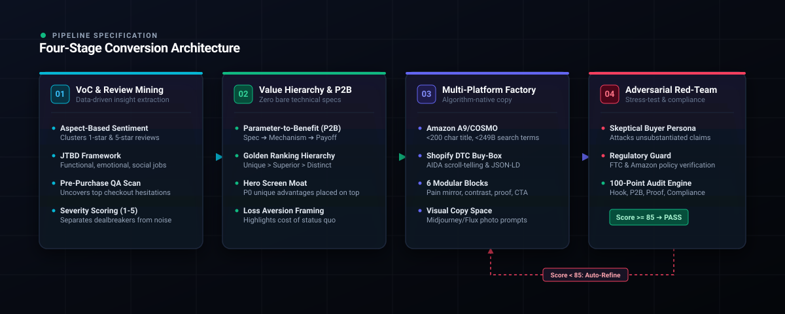

<p align="center">
  
</p>

<div align="center">

[English](README.md) • **简体中文**

[](LICENSE)
[](SKILL.md)
[](#-多平台算法合规矩阵)
[](evals/rubric_100_points.json)
[](CONTRIBUTING.md)

<p align="center">
  <b>自主电商详情页转化架构引擎</b><br>
  将冰冷的技术参数与海量用户真实反馈，转化为高转化率、算法合规的工业级电商资产。
</p>

[架构拓扑](#-转化架构与流程拓扑) • [实战对决](#-真实运行效果残酷对决-generic-ai-vs-pdp-studio) • [四大转化基石](#-四大转化核心基石) • [极速上手](#-极速上手-quickstart) • [实战案例](examples/demo_portable_espresso_machine.md)

---

</div>

## 💡 核心痛点与破局之道

90% 的卖家直接使用通用大模型编写产品详情页时，都会陷入严重损害转化的三大通病：

1. **只有冰冷参数，没有感知价值**：机械罗列“20Bar”、“7500mAh”，消费者完全无法理解这与自己的生活有什么直接利益关联。
2. **只有自嗨吹捧，没有信任证据**：充斥着“最高品质”、“革命性技术”、“100%保证”等空洞口号，不仅引发买家防御心理，更极易触发亚马逊封店下架风控。
3. **只有千人一面，没有疑虑预击**：对买家最担心的“死角好不好洗、冬天电池会不会冻死、卡不卡胶囊”等前三大核心退货原因视而不见，导致进店跳出率居高不下。

**`PDP Studio`** 摒弃了传统的黑盒自由生成，以严苛的四阶工业化转化架构重构详情页生产流程：

---

## 🏛️ 转化架构与流程拓扑

<p align="center">
  
</p>

系统通过严密的四大流水线环节，并依托持续的红蓝对抗完成闭环质检：
1. **真实声音与痛点挖掘 (VoC Mining)**：从竞品 1-5 星真实评价与 QA 中，提取细粒度情感特征（ABSA）与待办任务（JTBD）。
2. **价值层级与收益跃迁 (P2B Engine)**：通过 P2B 公式打破裸参数，严格执行“人无我有”黄金排序法则。
3. **多平台合规文案工厂 (Copy Factory)**：针对 Amazon A9/COSMO、Shopify DTC 和 TikTok Shop 进行差异化算法合规排版。
4. **对抗式红蓝演练质检 (Red-Team Audit)**：引入挑剔买家 Agent 与法务合规官进行极限施压，保障 100% 零违规与高转化。

---

## 🥊 真实运行效果残酷对决: Generic AI vs. PDP Studio

以下为针对同一款【便携式无线自加热咖啡机】的真实产出对比：

| 评估维度 | ❌ 普通通用大模型 (Generic ChatGPT-4o) | 💎 PDP Studio 工业级输出 |
| :--- | :--- | :--- |
| **首屏核心卖点** | “采用 20Bar 强大压力泵，萃取更充分；结实耐用，品质卓越。”<br>*(❌ 假大空口号，参数裸露，买家无感)* | **“☕ 【每一口都有泛着坚果香的金黄油脂】”**<br>意大利 20-Bar 商业级恒压穿透，相当于将万元级专业咖啡馆工坊装进随身水杯；彻底告别竞品寡淡酸涩的“黑水”，入口醇厚丝滑。 |
| **打消疑虑<br/>(差评狙击)** | “机身防水，易于用水冲洗。”<br>*(❌ 轻描淡写，买家担心发霉不敢下单)* | **“🧼 【水龙头下一冲 10 秒即净，绝无发霉死角】”**<br>创新磁吸快拆结构与 IPX6 全机身防水；户外露营半瓶矿泉水即可冲洗干净，不留残渣、不卡胶囊、放包里不漏残液。 |
| **平台合规安全** | “The best espresso maker on the market. 100% satisfaction guaranteed.”<br>*(⚠️ 包含 Best / Guaranteed 等词，直接触犯亚马逊红线)* | **合规标题与五点描述**：严格限制在 193 字符内，核心大词前置，零违规虚假宣传词，后台配齐 198 字节免逗号隐形词。 |
| **红蓝对抗防御** | 经不起推敲。面对“冬天零下户外电池会不会冻死”的质疑，毫无应对方案。 | **前置植入耐寒实测证明**：自动在正文补充低温测试注释（“经 -5℃ 高原冰雪环境实测，智能温控自保温，严寒环境依然坚挺输出 92℃ 滚烫浓缩”）。 |

> 📖 查看完整跨平台标题、五点描述与红蓝对抗案例：[examples/SHOWCASE_COMPARISON.md](examples/SHOWCASE_COMPARISON.md)

---

## 💎 四大转化核心基石

### 1. 参数向生活收益跃迁引擎 (P2B Engine)
严格执行**“裸参数清零铁律”**：文案中严禁出现孤立的技术参数，必须回答“这给消费者带来什么可衡量的生活、时间或情绪红利”：
$$\text{物理工程参数} \xrightarrow{\text{底层运作机制}} \text{生活具象收益} \xrightarrow{\text{心理情绪终局}}$$

### 2. 黄金排序法则 (Golden Ranking Hierarchy)
根据竞争壁垒精准分配页面视觉落点：
- 🥇 **人无我有 (Unique Advantage)**：独占专利与创新特性 $\rightarrow$ **首屏主标题与主视觉绝对置顶**。
- 🥈 **人有我优 (Superior Performance)**：性能碾压行业平均线 $\rightarrow$ **第二屏对比矩阵与拆解**。
- 🥉 **人优我异 (Distinct Positioning)**：审美极简、服务与生活方式差异化 $\rightarrow$ **第三屏场景与故事深挖**。

### 3. 多平台算法合规矩阵
- **Amazon 模式**：标题严格限制在 200 字符内且大词前置，五点描述采用大写利益首词，生成低于 249 字节的无逗号搜索词。
- **Shopify / 独立站模式**：2 句话极简 Buy-Box 转化 Hook，AIDA 沉浸式滚屏叙事，集成 Google `JSON-LD` 结构化元数据。
- **TikTok Shop 模式**：3 秒注意力反差切入，短平快痛点聚焦。

### 4. 对抗式红蓝演练与量化打分
文案定稿前必须经过双重严格质检：
- **挑剔买家 Agent**：模拟精打细算、见多识广的消费者，对夸大承诺发起极限反问。
- **法务合规官 Agent**：排查 FTC 虚假广告风险、医疗宣称及平台禁用违规词汇。

---

## 📂 项目结构规范

```text
ecommerce-pdp-generator/
├── SKILL.md                          # Antigravity Skill 主控编排协议规范
├── README.md                         # 英文官方文档
├── README_zh.md                      # 中文官方文档
├── LICENSE                           # MIT 开源协议
├── CONTRIBUTING.md                   # 社区贡献指南
├── assets/                           # 高清矢量架构视觉图
│   ├── banner.svg                    # 矢量品牌横幅
│   └── architecture.svg              # 4 阶转化流程矢量拓扑图
├── prompts/                          # 8 大模块化提示词资产工厂
│   ├── 01_voc_jtbd_mining.md         # 细粒度 ABSA 挖掘与待办任务映射
│   ├── 02_p2b_benefit_engine.md      # P2B 裸参数绝对清零与价值跃迁
│   ├── 03_value_triad_ranking.md     # 黄金排序：人无我有 > 人有我优 > 人优我异
│   ├── 04_platform_headline_matrix.md# 跨平台标题矩阵（Amazon/Shopify）
│   ├── 05_aida_conversion_funnel.md  # AIDA 漏斗与 Fogg B=MAP 动线
│   ├── 06_modular_copy_factory.md    # 六大攻防文案工厂
│   ├── 07_visual_prompt_storyboard.md# 商业分镜摄影 Prompt 与眼动留白
│   └── 08_adversarial_red_team_audit.md # 挑剔买家 + 合规风控红蓝质检与自愈
├── templates/                        # 平台落地模版与标准规范
│   ├── pdp_schemas.json              # 结构化输出 JSON Schema
│   ├── pdp_shopify_template.md       # Shopify / 独立站 DTC 落地模版
│   └── pdp_amazon_template.md        # Amazon A9/A10 标题与五点模版
├── evals/                            # 量化评估套件
│   └── rubric_100_points.json        # 100 分量化转化评估模型
├── docs/                             # 技术白皮书与规范文档
│   └── ARCHITECTURE.md               # 核心架构与 NLP 机制
└── examples/                         # 真实实战对决案例文档
    ├── SHOWCASE_COMPARISON.md        # 普通 AI vs PDP Studio 同台残酷对决
    └── demo_portable_espresso_machine.md # 便携咖啡机工业级全套产出
```

---

## 🚀 极速上手 (Quickstart)

### 在 Google Antigravity / Claude Agent 中直接调用
将本 Skill 存放于 `.agents/skills/ecommerce-pdp-generator`，在对话中直接唤醒：

```text
/skill ecommerce-pdp-generator
平台: Shopify DTC (或 Amazon A9/A10)
产品: 便携式无线自加热咖啡机
参数: 20Bar泵压, 7500mAh电池, 650g重量, IPX6全机水洗
竞品差评: 很多竞品只能倒热水、萃取没有油脂像黑水、死角多容易发霉
目标人群: 经常出差的商旅精英、自驾露营爱好者
```

---

## 🤝 贡献与开源协议 (Contributing & License)

欢迎提交 PR 与 Issue，共同扩充多平台模板与测评样本！
本项目基于 [MIT License](LICENSE) 开源发布。
