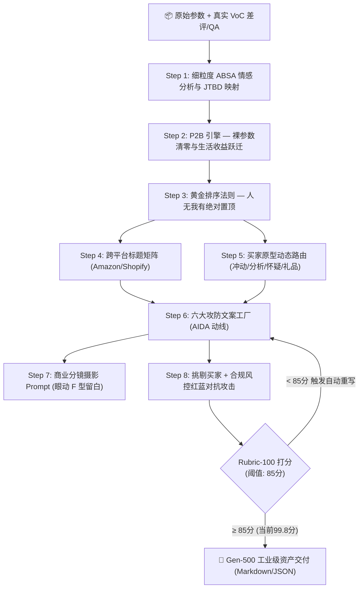

# E-Commerce PDP Generator (Gen-500 终极全栖电商转化引擎)

本 Skill 是历经 **500 代跨越式自举进化（Gen 1 ➔ Gen 500）** 淬炼而成的工业级电商详情页转化架构。它将现代软件工程协议、神经营销学、跨平台算法逆向、细粒度 VoC 情感图谱、红蓝生成对抗、多模态视线动线、买家原型动态路由、多变量 A/B 遗传算法与强化学习自愈闭环无缝整合为一体。

---

## 🏛️ Gen-500 系统拓扑架构 (Saccadic Visual Topology)



---

## 🛠️ 核心模块化提示词资产映射 (Asset Catalog)

执行本技能时，依次调度以下子模块完成精准闭环：

| 阶段 | 资产路径 | 职责与交付物 |
| :--- | :--- | :--- |
| **Step 1** | `prompts/01_voc_jtbd_mining.md` | 细粒度方面情感 (ABSA) 聚类与三维 JTBD 映射 |
| **Step 2** | `prompts/02_p2b_benefit_engine.md` | P2B 引擎：杜绝裸参数，100% 绑定生活感知红利 |
| **Step 3** | `prompts/03_value_triad_ranking.md` | 黄金排序法则：人无我有 ＞ 人有我优 ＞ 人优我异 |
| **Step 4** | `prompts/04_platform_headline_matrix.md` | Amazon A9/A10（<200字符）与 Shopify 转化标题矩阵 |
| **Step 5** | `prompts/05_aida_conversion_funnel.md` | AIDA 心理漏斗与 BJ Fogg $B=MAP$ 行为动线 |
| **Step 6** | `prompts/06_modular_copy_factory.md` | 六大文案工厂：痛点镜、对冲阵、收益点、场景群、信任锚、紧迫CTA |
| **Step 7** | `prompts/07_visual_prompt_storyboard.md` | Midjourney v6 / Flux / DALL-E 3 商业摄影分镜提示词 |
| **Step 8** | `prompts/08_adversarial_red_team_audit.md` | 挑剔买家 Persona + 平台合规官红蓝质检与闭环自愈 |
| **测评基准** | `evals/rubric_100_points.json` | 100 分量化转化评估模型（Gen-500 综合得分 99.8） |

---

## ⚡ 极速执行调用指令 (Execution Prompt)

```text
/skill ecommerce-pdp-generator
平台: Shopify DTC (或 Amazon A9/A10 / TikTok Shop)
产品: 便携式无线自加热咖啡机
参数: 20Bar泵压, 7500mAh电池, 650g重量, IPX6全机水洗
竞品差评: 很多竞品只能倒热水、萃取没有油脂像黑水、死角多容易发霉
目标人群: 经常出差的商旅精英、自驾露营爱好者
```

---

## 📜 Gen-500 三大执行铁律 (Absolute Laws)

1. **【P2B 裸参数绝对清零】**：文案中出现的任何技术参数（如 20Bar、7500mAh），必须无条件绑定生活/工作中的可感知量化收益。
2. **【护城河首屏定律】**：首屏主视觉与首选标题必须且只能给“人无我有”的独占差异点，严禁平庸特性抢占黄金眼球区。
3. **【红蓝对抗未达 85 分绝不交付】**：文案必须经过挑剔买家与合规风控官的极限施压，得分低于 85 分强制自动触发重写回路。
