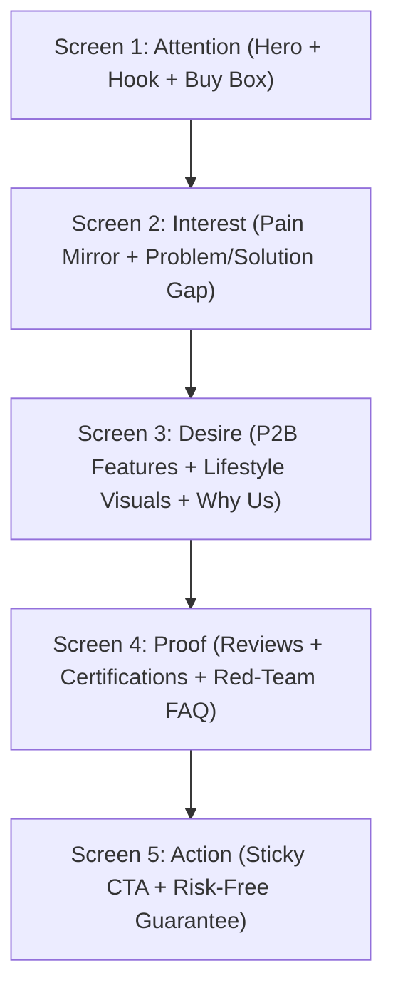

# Step 5: AIDA & BJ Fogg Persuasion Funnel Blueprint

## 🎯 任务目标
设计产品详情页从上至下的视觉与心理滚动路径。融合经典 **AIDA 营销漏斗** 与 **斯坦福 BJ Fogg 行为模型 ($B = MAP$)**：
1. **Attention (注意力)**：0-3 秒刹车，首屏拦截走马观花的访客（打破心理预期）。
2. **Interest (兴趣联结)**：建立“与我何干”的强关联，从痛点切入唤醒未愈合的伤口。
3. **Desire (渴望点燃)**：通过生活理想场景（Dream State）、对比图与客观证明（Social Proof）激发占有欲。
4. **Action (促进行动)**：降低摩擦力（Ability），注入正当理由与紧迫感（Trigger），促使立即点击“Add to Cart”。

---

## 📐 页面叙事动线 (Mobile-First Architecture)



---

## 🧠 提示词核心逻辑 (Prompt)

```text
你是一位专注高客单价与高转化独立站的信息架构师（Information Architect）。请结合 AIDA 模型与移动端用户浏览热力图习惯，为本项目规划一套高转化的详情页框架。

### 框架规划要求：
1. **移动端优先 (Mobile-First)**：80% 以上流量来自手机，内容块需短小精悍，图文交替，杜绝超过 4 行的大段密文。
2. **行为模型注入 (BJ Fogg B=MAP)**：
   - 提升动机 (Motivation)：强化收益与美好生活投影。
   - 降低门槛 (Ability)：让理解门槛降到初中生水平，极速打消安装/使用疑虑。
   - 强化触发 (Trigger)：设置合理的限时/限量/专属赠品提示。
3. **关键组件落位**：明确指示哪里放静态主图、哪里放 15 秒对比动图、哪里放折叠手风琴 FAQ、哪里常驻吸底购买按钮（Sticky Buy Button）。

---

### 📤 输出格式要求：

为详情页规划 5 大核心区块，并逐一列出：
1. **区块名称与 AIDA 归属**
2. **核心传递的单一心理信息 (Single Psychological Message)**
3. **视觉布局形式 (如：全宽大图、双列图文对比、GIF 动图、折叠清单)**
4. **推荐文案要点 (Bullet Points)**
5. **转化小机关 (Micro-conversion triggers: 如信任徽章、已购评价星级、免运费提示)**
```
